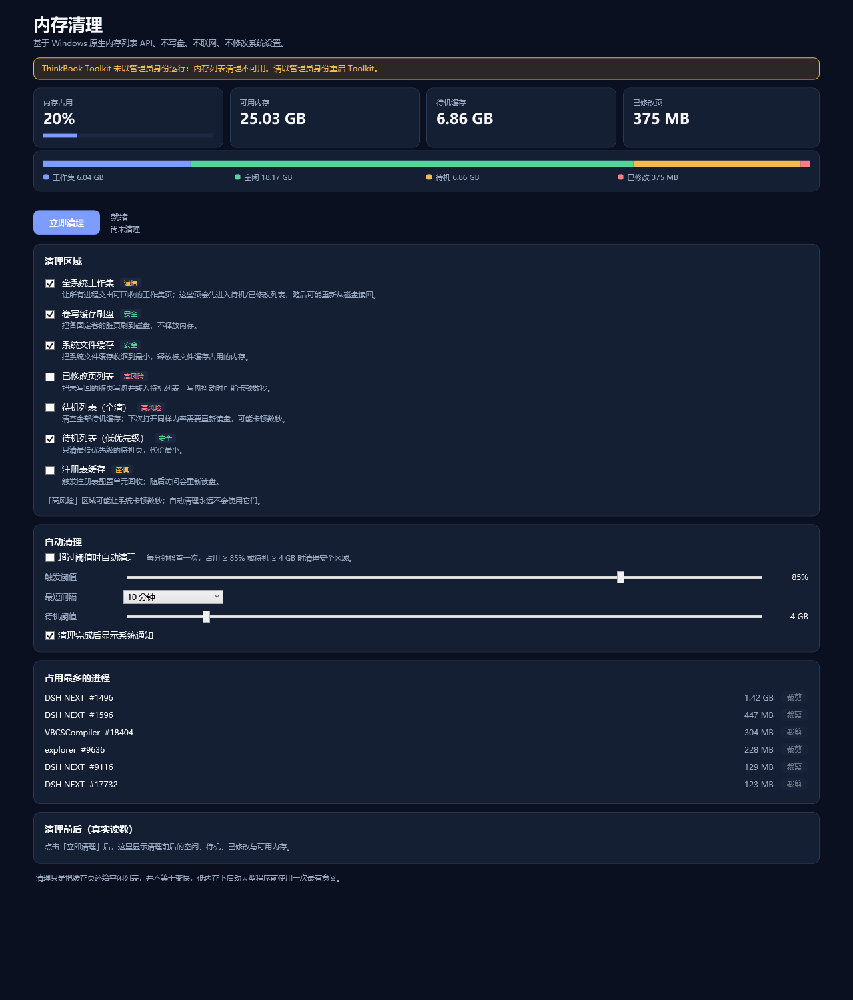
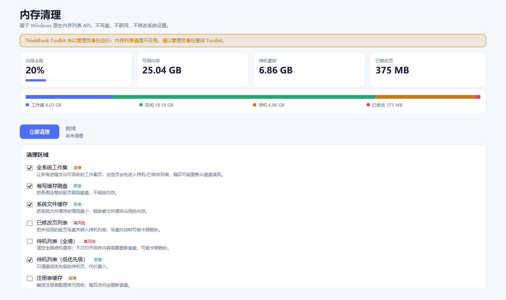
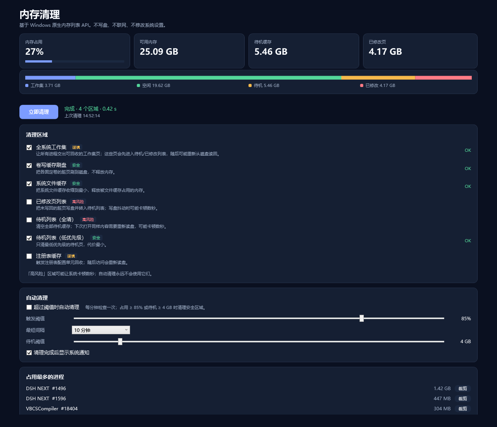

# TBT 内存清理插件 (tbt.memory.cleaner)

ThinkBook Toolkit 的内存清理插件：原生内存列表清理、内存构成可视化、系统通知、进程级裁剪。
不写盘、不联网、不改系统设置；所有数字都来自 `GlobalMemoryStatusEx` 与 `NtQuerySystemInformation(SystemMemoryListInformation)`。



## 功能

- **一键清理**：7 个区域独立勾选，默认只开 4 个安全区域
- **证据表**：清理前后对比工作集 / 空闲 / 待机 / 已修改 / 可用，口径与资源监视器一致
- **内存构成条**：一条 100% 堆叠条，直观看出「清理把什么变成了什么」
- **传感器**：可用内存 / 内存占用 / 待机缓存并入 ToolKit 的内存卡、OSD 与传感器记录
- **自动清理**：三个触发源——占用率、待机缓存大小、系统低内存事件
- **Windows 通知**：右下角系统通知，点一下就回到 Toolkit
- **进程列表**：占用最多的 6 个进程，可单独裁剪某一个的工作集
- 中英双语、深浅色主题

| 清理 | 证据表 |
|---|---|
|  |  |

## 清理区域

| 位 | 区域 | 调用 | 特权 | 默认 | 风险 |
|---|---|---|---|---|---|
| 1 | 全系统工作集 | `NtSetSystemInformation(0x50, MemoryEmptyWorkingSets)` | SeProfileSingleProcess | 开 | 谨慎 |
| 2 | 系统文件缓存 | `SetSystemFileCacheSize(-1, -1, 0)` | SeIncreaseQuota | 开 | 安全 |
| 4 | 卷写缓存刷盘 | 逐卷 `FlushFileBuffers` | 管理员 | 开 | 安全 |
| 8 | 待机列表（低优先级） | `(0x50, MemoryPurgeLowPriorityStandbyList)` | SeProfileSingleProcess | 开 | 安全 |
| 16 | 待机列表（全清） | `(0x50, MemoryPurgeStandbyList)` | SeProfileSingleProcess | 关 | 高 |
| 32 | 已修改页列表 | `(0x50, MemoryFlushModifiedList)` | SeProfileSingleProcess | 关 | 高 |
| 64 | 注册表缓存 | `(0x9B, NULL, 0)`（8.1+） | SeProfileSingleProcess | 关 | 谨慎 |

> **实测提醒**：低优先级待机在很多机器上只占很小一块。本机实测 6.82 GB 待机，低优先级清理 **0 效果**（2 ms 返回），全清才把它降到 0.00 GB（818 ms，空闲 +6.9 GB）。所以「待机阈值」触发要真正生效，需要同时勾选「待机列表（全清）」。

## 自动清理

| 触发 | 设置 | 说明 |
|---|---|---|
| 占用率 | `auto-threshold`（默认 85%） | 内存占用超过阈值 |
| 待机缓存 | `auto-standby-gb`（默认 4 GB，0 关闭） | 待机超过阈值时清理；只由它触发时不会裁剪工作集 |
| 系统低内存 | 无需设置 | `CreateMemoryResourceNotification` 事件 |

- 自动清理**永远不使用**「待机全清 / 已修改页 / 注册表缓存」以外的危险区域——除全清外，其余靠勾选决定
- 每次清理后若待机没有降到阈值的 90% 以下，退避 10 分钟，避免空转
- 最短间隔由 `auto-interval` 控制（默认 10 分钟）

## 安装

1. 退出 Toolkit
2. 把 `tbt.memory.cleaner` 文件夹复制到 `%USERPROFILE%\.thinkbook_toolkit\plugins\`
3. 启动 Toolkit → 插件页 → 审核并启用「内存清理」

也可以在插件页「导入插件」里直接选 Release 里的 zip。

权限：`ui.custom`（自绘页面）、`ui.toast`（回退提示）、`settings.read`（读取界面语言）。

## 构建

前置：.NET 9 SDK、已安装 ThinkBook Toolkit（契约 DLL 从安装目录引用，不随包分发）。

```powershell
powershell -NoProfile -ExecutionPolicy Bypass -File build.ps1
powershell -NoProfile -ExecutionPolicy Bypass -File pack.ps1
```

- 必须用 `-m:1` 串行还原（多个 ProjectReference 并行还原会静默失败）
- 契约 DLL 用原始 `<Reference Private="false">`，**不进包、不在 deps.json 里声明**
- 打包脚本会断言：两个 `deps.json` 不含 `ThinkBookToolkit.`；逻辑 deps 必须声明 `TbtMemoryCleaner.Core`

## 验证

| 工具 | 用途 |
|---|---|
| `tools/Tests` | 21 项断言：区域掩码、设置解析、自动清理四象限、进程读取、通知文案 |
| `tools/HostSim` | 启动真实 `ThinkBookToolkit.PluginHost.exe`，走命名管道跑 5 轮 tick |
| `tools/ManifestCheck` | 反射调用装机版自己的 `ValidateManifest` 校验清单 |
| `tools/UiRender` | 离屏渲染深/浅色 × 1280/900，含滚轮、勾选、点击的交互断言 |
| `tools/LiveTest` | 提权后实测清理前后数值 |

真机 E2E 记录见 [docs/verification.md](docs/verification.md)。

## 设计说明

- **手动清理在页面进程**（Toolkit 主进程）：宿主不会把插件自己的传感器值回传给页面，工作进程的结果无法回传
- **自动清理在工作进程**：页面只在导航时存在，不导航就不会清理
- 两端共用 `TbtMemoryCleaner.Core`，用 `Local\tbt.memory.cleaner.clean` 命名互斥体串行
- 通知用 `Shell_NotifyIcon` + 隐藏托盘图标，不依赖 WinRT 投影（那需要 26 MB 的 SDK 程序集）
- 插件目录**运行期零写入**，否则宿主指纹变化会导致授权失效

## 已知限制

- 「待机列表（全清）」会造成短暂卡顿（本机实测 818 ms），自动触发请谨慎
- 通知来源显示为进程名 `ThinkBookToolkit`；要做到显示「TBT 内存清理」需要注册 AUMID（写开始菜单快捷方式 + 注册表），本项目未做
- 仅在 ThinkBook Toolkit 1.0.4 + Windows 11 实测

## License

MPL-2.0
